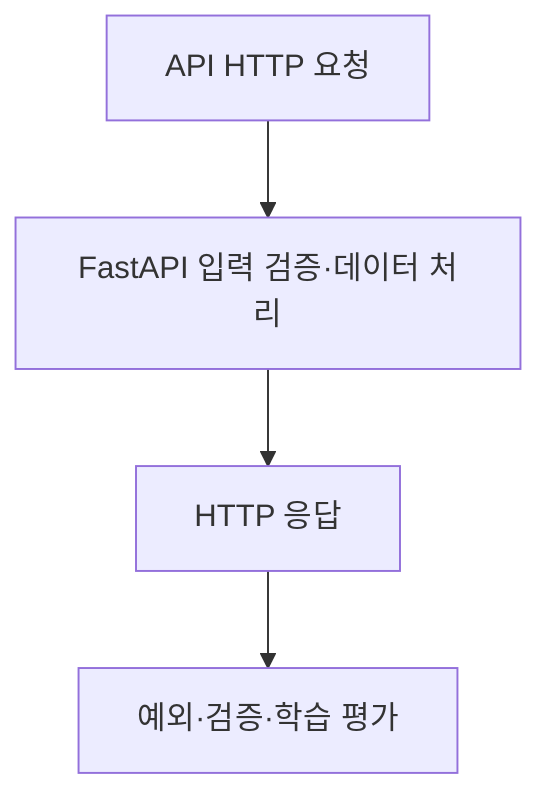

# B6-2 — 기술 학습 9요소 개요

> **PLAN_ONLY / NOT_VERIFIED.** FastAPI 게시판 CRUD 분야의 용어·개념·아키텍처·주요 코드 학습을 위한 준비 문서입니다. 00단계 교육 계획과 실제 코드·실습 증빙을 혼동하지 않습니다.

## 1. 용어·개념 미리보기

| 순서 | 먼저 배울 기술 용어 | 이후 확인할 내용 |
|---|---|---|
| 1 | **HTTP** | 한글·영어 정의, 역할, 필요성, 예제, 반례 |
| 2 | **Route** | 한글·영어 정의, 역할, 필요성, 예제, 반례 |
| 3 | **Request** | 한글·영어 정의, 역할, 필요성, 예제, 반례 |
| 4 | **Schema** | 한글·영어 정의, 역할, 필요성, 예제, 반례 |
| 5 | **CRUD** | 한글·영어 정의, 역할, 필요성, 예제, 반례 |
| 6 | **Response** | 한글·영어 정의, 역할, 필요성, 예제, 반례 |

**핵심 주제:** FastAPI 게시판 CRUD. 학습자는 이 기술이 왜 필요한지, 다른 기술과 무엇이 다른지 설명할 수 있어야 합니다.

## 2. 개념 아키텍처 — 교육용 Mermaid

**주의:** 개념의 관계를 보여주는 **설명용 그림**입니다. 실제 시스템 설계는 03단계, 구현은 별도 승인 이후 04단계입니다.

## 3. 9가지 기술 학습 요소

| 교육 요소 | 이번 미션에서 준비할 학습 자료 |
|---|---|
| ① 용어 | HTTP·Route·Request 등 한글/영어 정의 |
| ② 개념 | 왜 필요한지·작동 원리·선행 지식 |
| ③ 비유 | 일상 비유와 비유의 한계 |
| ④ 아키텍처 | 입력·처리·출력·실패·보안 경계 |
| ⑤ 주요 코드 | 경로함수·검증·DB 연계 (실제 코드는 04 승인 이후) |
| ⑥ 실행 흐름 | 예측→실행→상태·출력 변화 관찰 |
| ⑦ 오류 해결 | 재현·증거·원인·수정·재검증 |
| ⑧ 실습 | PRIMM(Predict·Run·Investigate·Modify·Make) |
| ⑨ 평가 | 공식 요구·학습 목표·L1~L5·독립 수행 |

## 4. 기존 단계 연결과 검증 경계

**00:** 개념 학습 계획 → **01:** 공식 요구와 평가 매핑 → **02:** 선행 학습 분석 → **03:** 실제 설계 → **04:** 별도 승인 후 새 코드 → **05~07:** 시험·증빙·숙달 검증 → **08:** 학습 슬라이드/실습자료 → **09:** 인계.

<ins>실제 코드 개발·실행·학습자 숙달은 아직 미실시입니다.</ins> 이전 Round의 코드·PASS는 참고만 하며 신규 미션 증빙으로 사용하지 않습니다.

[중앙 학습 표준](https://github.com/MetaStudy999/codyssey-basic/blob/main/standards/LEARNER-CENTERED-AI-LEARNING-STANDARD.md) · [미션 학습계획](LEARNING-SYSTEM-PLAN.md) · [00단계 README](README.md).

## 5. 한글·영어·공식 약어와 설명·재현 확인

처음 나오는 기술 용어를 **한글명(English Full Name, 공식 약어)**로 익힙니다. 별도 약어가 없는 경우에는 만들지 않습니다.

| 한글명 | 영어 원명 | 공식·통용 약어 | 한 줄 설명 |
|---|---|---|---|
| **생성·조회·수정·삭제** | Create, Read, Update, Delete | CRUD | 기본 데이터 처리 네 가지 |
| **응용 프로그램 프로그래밍 인터페이스** | Application Programming Interface | API | 서비스와 요청을 연결하는 규칙 |
| **하이퍼텍스트 전송 규약** | Hypertext Transfer Protocol | HTTP | 웹 요청·응답에 쓰이는 규약 |
| **자바스크립트 객체 표기법** | JavaScript Object Notation | JSON | 데이터 교환에 많이 쓰이는 텍스트 형식 |

**자기 말로 설명:** CRUD(Create, Read, Update, Delete)는 데이터를 만들고 읽고 수정하고 지우는 네 가지 기본 행동입니다. 웹서비스 요청이 어떤 종류인지 구분하도록 돕습니다.

**종이 재현 예상 단계**
1. 사용자가 게시글 수정을 요청했다고 가정.
2. 요청값을 확인하고 수정 작업을 처리할 계획 세우기.
3. 수정된 내용 또는 오류를 응답한다고 예상.

**오해와 한계:** CRUD 네 작업이 실제로 성공했다는 주장은 HTTP 상태·데이터 결과·테스트 검증을 요구합니다.

**학습 확인:** 용어를 말하고, 순서를 종이에 다시 그리고, 예상 결과와 실제 측정의 차이를 설명할 수 있나요?

**상태:** 교육용 설명·예상답만 기재. 실제 신규 구현, 테스트 및 학습자 L4/L5 독립 재현은 NOT_STARTED / NOT_VERIFIED.
